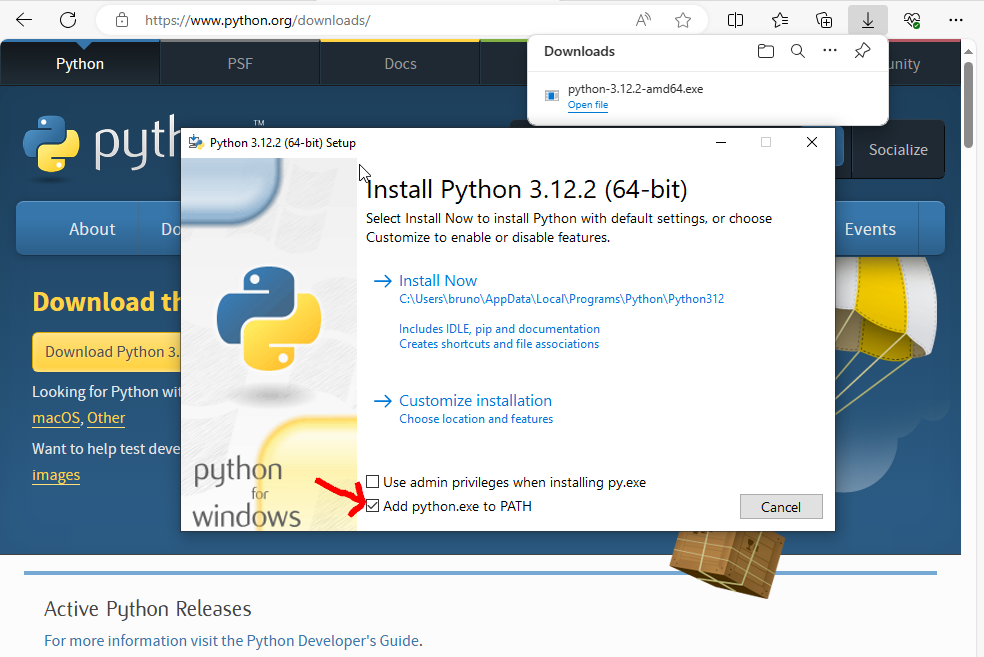
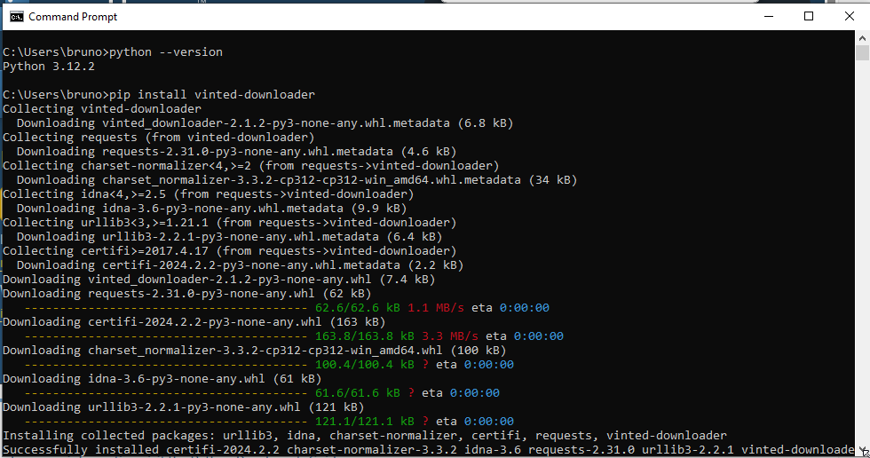
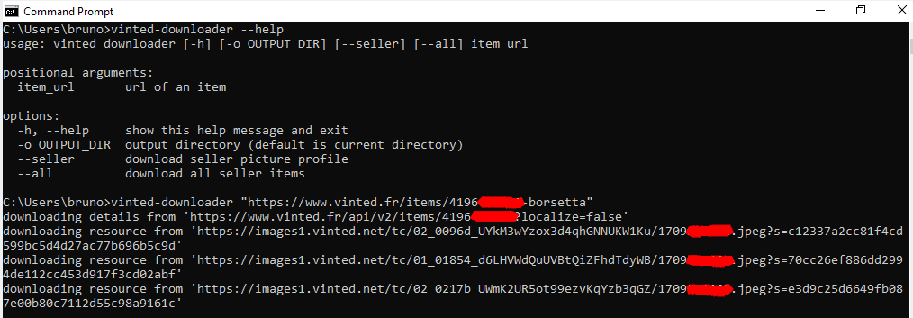

# Vinted Product Downloader

Vinted is a website to buy and sell second-hand clothes available in several countries in Europe.  Sometimes it's useful to download the photographs of an article.

This Python script downloads the item details and photographs available from a Vinted listing.

- Extract item details from supported older page formats and current server-rendered HTML / Next.js data.
- Prefer photo `full_size_url` values when supplied in the item data or found through the seller's wardrobe API.
- Fall back to the photo URLs available in the listing page when full-size URLs cannot be retrieved. These may be resized images, commonly using the `f800` rendition.
- Download the seller's profile picture with `--seller`.
- Download the seller's available wardrobe items with `--all-items`.

Full-resolution downloads are not guaranteed. A `full_size_url` identifies the image Vinted supplies through that field; it does not guarantee a particular pixel size or the seller's unmodified camera original. The script does not upscale or re-encode images.

## Usage

```bash
# Download item pictures to current directory
python vinted_downloader.py "ITEM_URL"

# Download item pictures and seller profile to current directory
python vinted_downloader.py --seller "ITEM_URL"

# Download all items available on the seller profile
python vinted_downloader.py --all-items "ITEM_URL"
```

Then you get the following files:

- `item.json`: extracted item metadata; available fields depend on the source response.
- `item_summary`: source URL, title, seller name and seller ID where available.
- `photo_00.jpeg`, `photo_01.jpeg`, etc.: item photos, numbered from zero. Extensions follow the image URLs, so files may instead use `.webp` or another extension.
- `seller.webp`: seller profile picture (when requested with `--seller`).

With `--all-items`, each item's metadata, summary and photos are placed in a subdirectory named after its numeric ID.

Unexpected extraction or JSON-decoding failures may save the server response to `vinted_product_downloader_error.txt` for diagnosis.

Use the `--output` option to specify an output directory (default is current directory).  If it doesn't exist, it will be created. If you want to save the files in a subdirectory of the output directory automatically named after the item id and title, then use the `--save-in-dir` option.

For example, to automatically create and save in the `my-output/1234-item-title/` directory, run:

```bash
python vinted_downloader.py --output my-output --save-in-dir "https://www.vinted.fr/items/1234-item-title"
```

If you have installed the package with `pip`, you can also use the `vinted-downloader` command:

```bash
vinted-downloader "ITEM_URL"
vinted-downloader --seller "ITEM_URL"
vinted-downloader --all-items "ITEM_URL"
```

## Unavailable listings and errors

A sold or otherwise inactive listing may still expose its item details and resized photos. The script attempts to find the same item in the seller's wardrobe to obtain full-size URLs. An item missing from that response does not by itself prove it was sold or that its image files were deleted; visibility can also differ between regional domains.

For HTTP 404/410 responses to the item-page request, or Vinted's rendered `page-not-found` screen even with HTTP 200, the script prints an **Item unavailable** message and exits with status **1**, without a traceback or an error dump. Other HTTP errors on the item-page request and network errors that stop the download are reported separately with status 1. A failed wardrobe lookup falls back to the page photos. Successful completion returns status 0.

When Vinted returns only its not-found page, there are no listing details or photo URLs to extract. Recovering them requires another source, such as an archived page or previously saved metadata/image URLs. A missing listing does not establish whether previously saved image URLs still work.

## Firefox extension

The upstream author also provides a separate [Firefox extension](https://addons.mozilla.org/en-US/firefox/addon/vinted-photo-data-downloader/), with [source code on GitHub](https://github.com/boberle/vinted-downloader-firefox-addon). Changes to this Python script do not update the extension.

## How to install?

The PyPI package uses the version installed in your environment, which may differ from the source checkout. To run the code in this repository, follow the source installation instructions and use `python vinted_downloader.py`.

### With pip

#### On Linux or MacOS

The Vinted product download is on PyPI, so you can run:

```bash
pip install vinted-downloader
```

All dependencies are installed automatically.

You can then use the command `vinted-downloader` like this:

```bash
vinted-downloader [-o OUTPUT] [-s] [-a] [-d] "ITEM_URL"
```

or, if you prefer to use Python:

```bash
python -m vinted_downloader [-o OUTPUT] [-s] [-a] [-d] "ITEM_URL"
```

To update the package, run:

```bash
pip install --upgrade vinted-downloader
```

#### On Windows

First you need to install Python:

- Go to https://www.python.org/downloads/
- Download the installer "Python for Windows"
- Run the installer (click on the downloaded file)
   - Check "Add python.exe to PATH" (this is **VERY IMPORTANT**, see the image below)
   - Click "Install Now"



Then open the Command Prompt (type "prompt" in the search bar at the bottom of the screen):

- type `python --version` to check that Python is correctly installed (you should see the version of Python, and not an error message)
- type `pip install vinted-downloader`. This will install the downloader and its dependencies



Then use it, like described above. For example:

```bash
vinted-downloader "ITEM_URL"
vinted-downloader --seller "ITEM_URL"
vinted-downloader --all-items "ITEM_URL"
```



If the command `vinted-downloader` doesn't work, use:

```bash
python -m vinted_downloader "ITEM_URL"
```

To update, run:

```bash
pip install --upgrade vinted-downloader
```

### From the sources

Clone the GitHub repository and install the dependencies.

#### On Linux and MacOS

```bash
# Clone
git clone https://github.com/boberle/vinted-downloader.git

# Install dependencies
cd vinted-downloader
python -m venv venv
source venv/bin/activate
pip install -r requirements.txt

# Run
python vinted_downloader.py "ITEM_URL"
```

## How does it work?

The client opens the Vinted home page to establish an anonymous session, then requests the item URL using the same session.

It checks for unavailable pages and HTTP errors before extracting item details. Supported extraction methods include older embedded item data and current HTML, JSON-LD and Next.js Flight data.

When the page fallback supplies an item ID and seller ID, the script searches the seller's wardrobe at `/api/v2/wardrobe/SELLER_ID/items`, following pagination for up to ten pages. If the matching item supplies full-size photo URLs, those are preferred. Otherwise, the downloader uses the photo URLs available in the page data.

Photo URLs are used with their supplied paths and query parameters intact. The script does not generate signatures or guess original-size URLs from thumbnail URLs.

## Version

This is version 2. Not back compatible with version 1.
